<div align="center">

<a href="https://amb.watch">
  <picture>
    <source media="(prefers-color-scheme: dark)" srcset="assets/amb-logo.png">
    
  </picture>
</a>

<p><b>AMB Terminal</b> · a free project by <a href="https://amb.watch"><b>amb</b> (amb.watch)</a></p>

<h3>Free, local portfolio analysis for learning to invest</h3>

<p>
Track markets, keep a portfolio, backtest strategies and run real analytics -<br>
on your own computer. No account. No subscription. Nothing leaves your machine.
</p>

<p>
  
  
  
  
</p>

<p>
  <a href="#-quick-start"><b>Quick start</b></a> ·
  <a href="#-what-you-get"><b>Features</b></a> ·
  <a href="#-the-analysis-workbench"><b>Analysis tools</b></a> ·
  <a href="#-faq"><b>FAQ</b></a>
</p>

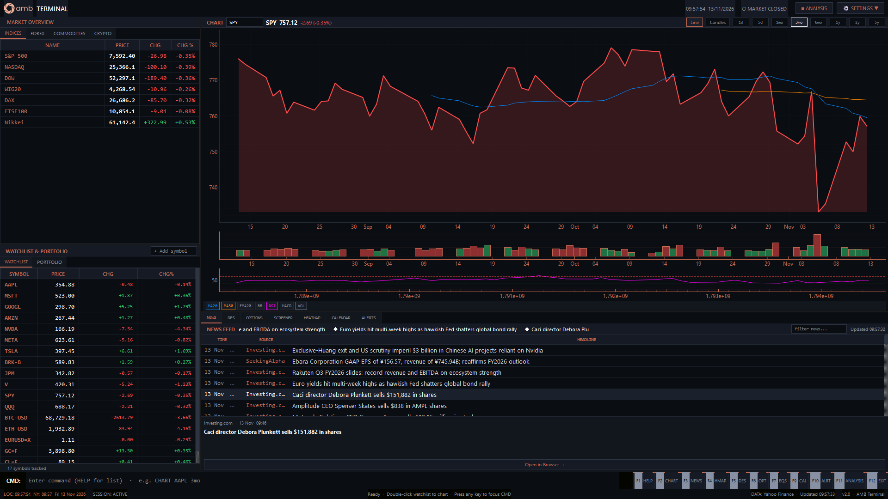

</div>

---

> 🇵🇱 **PL -** AMB Terminal to **darmowa** aplikacja desktopowa do prostych analiz portfela, działająca **lokalnie**.
> Notowania, newsy, Twój portfel i 12 narzędzi analitycznych (backtest, optymalizacja, Monte Carlo, analiza czynnikowa i inne)
> na realnych danych rynkowych - stworzona do **nauki inwestowania** i testowania własnych strategii.
> Instalacja: `pip install -r requirements.txt` → uruchomienie: `python main.py`.

## ✨ What you get

<table>
<tr>
<td width="50%" valign="top">

### 📈 A market view that's easy to read
Indices, FX, commodities and crypto, plus a watchlist with live-refreshing prices.
The chart defaults to a clean **line + area** view that beginners can actually read -
switch to **candlesticks** with one click when you want more detail.

</td>
<td width="50%" valign="top">

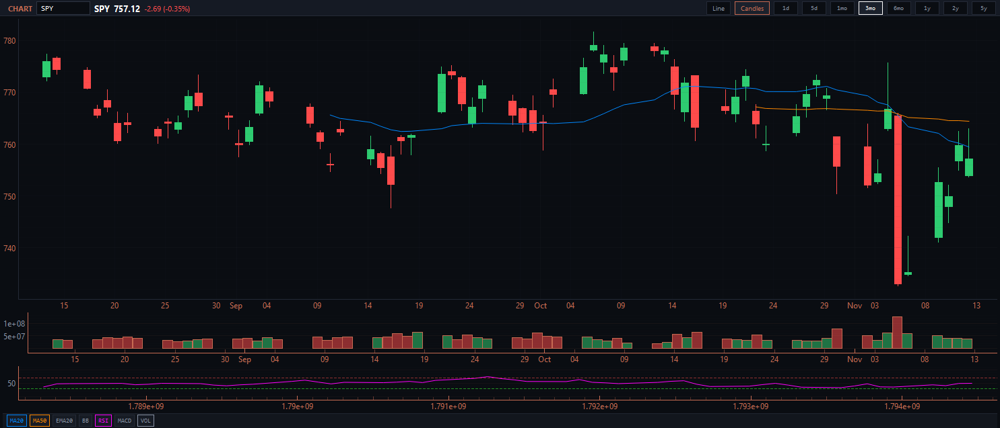

</td>
</tr>
<tr>
<td width="50%" valign="top">

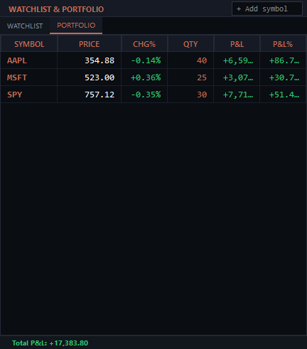

</td>
<td width="50%" valign="top">

### 💼 Your portfolio, wired into everything
Add positions straight from the watchlist and see P&amp;L update live. Every analysis tool has a
**Use My Portfolio** button that loads your real holdings (weighted by current market value) -
no retyping tickers.

</td>
</tr>
<tr>
<td colspan="2" valign="top">

### 📰 News with real timestamps
Headlines from Google News, Yahoo Finance, MarketWatch, CNBC, Investing.com and more, refreshed every ~90 seconds,
plus per-symbol news (`NEWS TSLA`).

</td>
</tr>
</table>

## 🧪 The Analysis Workbench

Twelve tools running on **real historical data** - each has its own screen, results chart and stats table.
Press **F11** (or type `ANALYSIS`) to open it.

<table>
<tr>
<td align="center" width="33%"><a href="docs/screenshots/backtest-portfolio.png">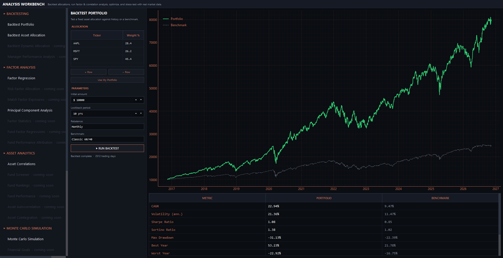</a><br><b>Backtest Portfolio</b><br><sub>growth, CAGR, Sharpe, drawdown vs. benchmark</sub></td>
<td align="center" width="33%"><a href="docs/screenshots/risk-parity.png">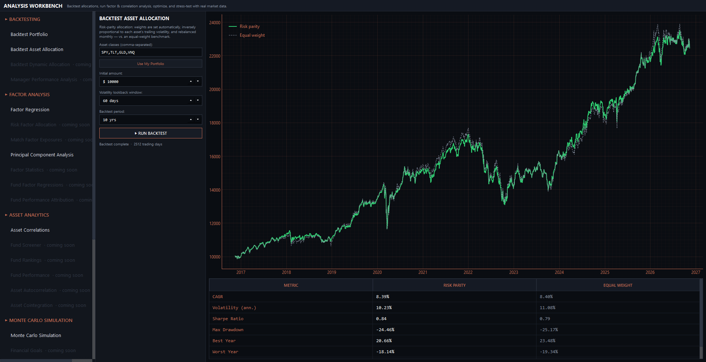</a><br><b>Backtest Asset Allocation</b><br><sub>risk-parity weights, rebalanced monthly</sub></td>
<td align="center" width="33%"><a href="docs/screenshots/efficient-frontier.png">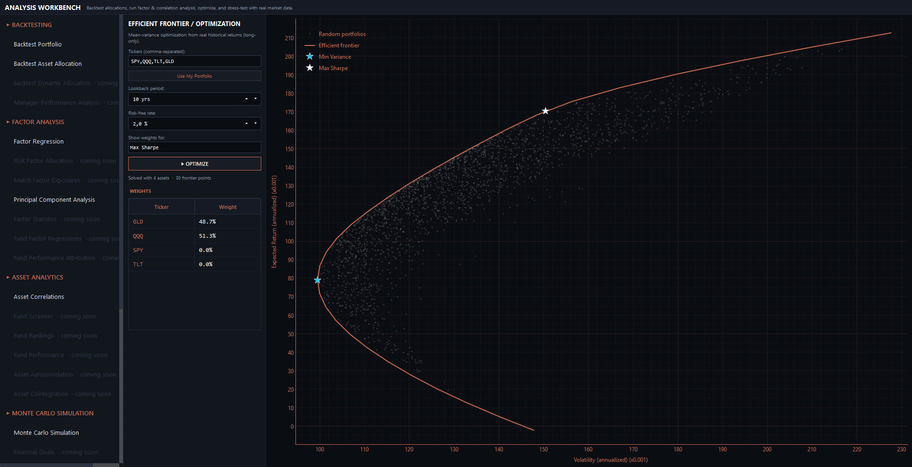</a><br><b>Efficient Frontier</b><br><sub>max-Sharpe &amp; min-variance portfolios</sub></td>
</tr>
<tr>
<td align="center"><a href="docs/screenshots/black-litterman.png">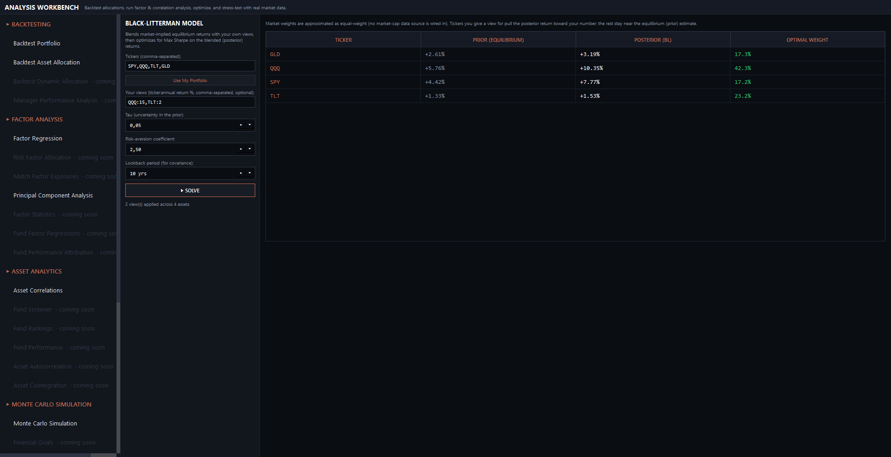</a><br><b>Black-Litterman</b><br><sub>blend market equilibrium with your views</sub></td>
<td align="center"><a href="docs/screenshots/rolling-optimization.png">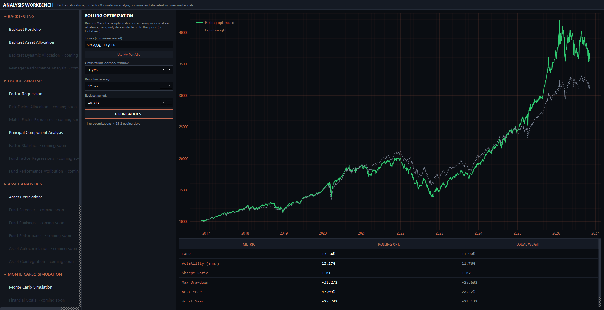</a><br><b>Rolling Optimization</b><br><sub>re-optimize each year, no lookahead</sub></td>
<td align="center"><a href="docs/screenshots/monte-carlo.png">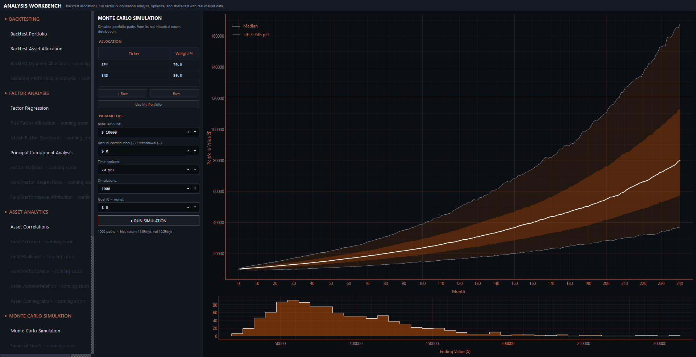</a><br><b>Monte Carlo</b><br><sub>fan chart, contributions, goal probability</sub></td>
</tr>
<tr>
<td align="center"><a href="docs/screenshots/factor-regression.png">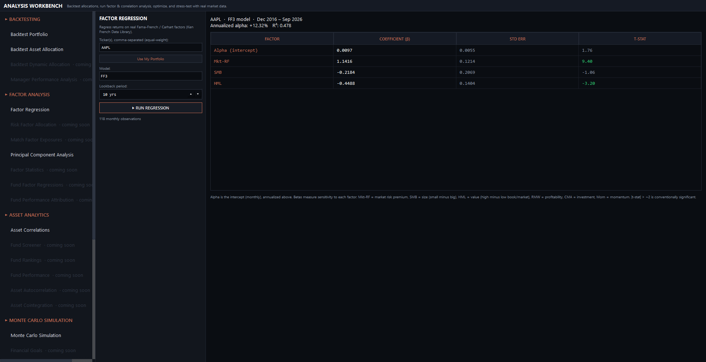</a><br><b>Factor Regression</b><br><sub>CAPM · Fama-French 3/5 · Carhart</sub></td>
<td align="center"><a href="docs/screenshots/pca.png">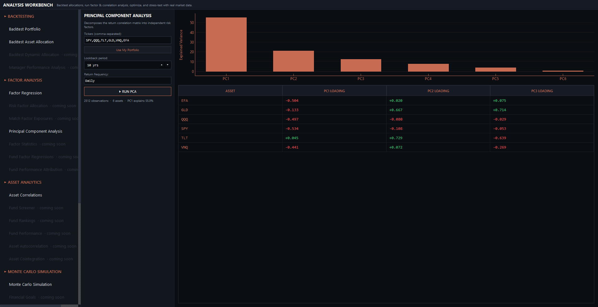</a><br><b>Principal Component Analysis</b><br><sub>what really drives your assets</sub></td>
<td align="center"><a href="docs/screenshots/correlations.png">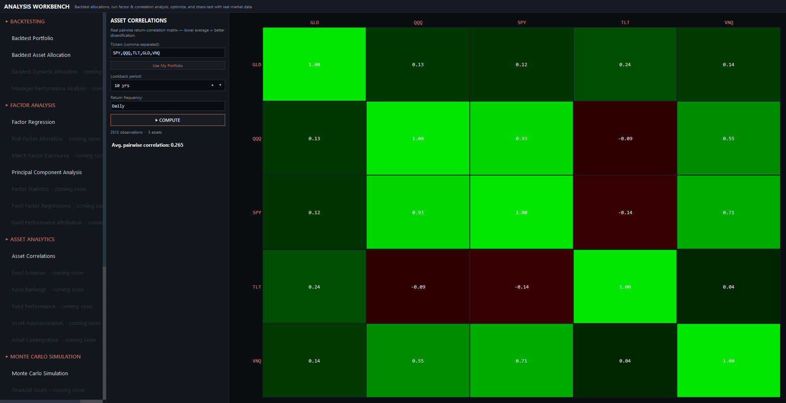</a><br><b>Asset Correlations</b><br><sub>diversification at a glance</sub></td>
</tr>
<tr>
<td align="center"><a href="docs/screenshots/momentum-rotation.png">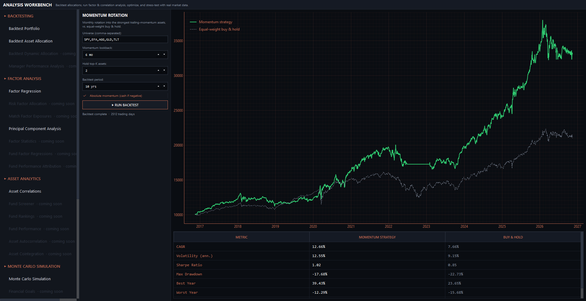</a><br><b>Momentum Rotation</b><br><sub>top-K trend following with cash filter</sub></td>
<td align="center"><a href="docs/screenshots/dual-momentum.png">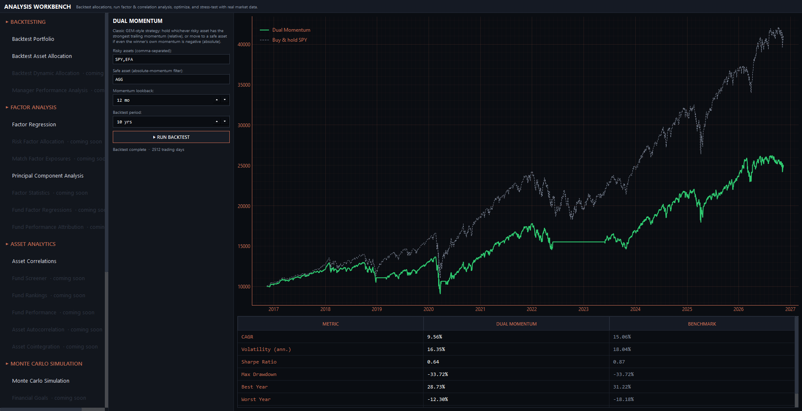</a><br><b>Dual Momentum</b><br><sub>relative + absolute momentum</sub></td>
<td align="center"><a href="docs/screenshots/target-volatility.png">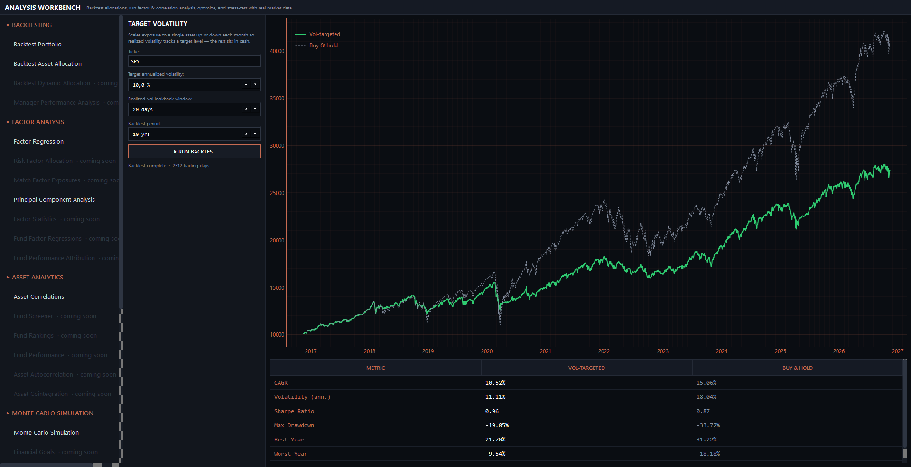</a><br><b>Target Volatility</b><br><sub>scale exposure to a risk budget</sub></td>
</tr>
</table>

<sub>Screenshots show live market data from the day they were generated. Click any image to enlarge.</sub>

## 🚀 Quick start

You need **Python 3.10 or newer**. Windows is the primary tested platform.

```bash
git clone https://github.com/amb-watch/local-terminal.git
cd local-terminal
pip install -r requirements.txt
python main.py
```

On Windows you can simply double-click **`install_and_run.bat`** instead.

When it starts, AMB asks **which monitor** to open on, shows the splash screen, then goes fullscreen.

| Key | Action |
|---|---|
| `F1` | Command reference |
| `F11` | Toggle Analysis Workbench |
| `F12` | Quit |
| any letter | Jump to the command bar |

<details>
<summary><b>⌨️ All commands (type them in the CMD bar)</b></summary>

<br>

| Command | What it does |
|---|---|
| `CHART AAPL 6mo` | Chart a symbol (or just type the ticker) |
| `NEWS TSLA` | Symbol-specific news |
| `DES AAPL` · `OPTIONS AAPL` | Fundamentals · options chain |
| `EQS` · `HMAP` · `ECO` · `ALRT TSLA 300` | Screener · sector heatmap · calendar · price alert |
| `WATCH NVDA` · `REMOVE NVDA` | Edit the watchlist |
| `ANALYSIS` | Open the Analysis Workbench |
| `BACKTEST` · `RISKPARITY` | Backtest a portfolio · risk-parity allocation |
| `OPTIMIZE` · `BL` · `ROLLINGOPT` | Efficient frontier · Black-Litterman · rolling optimization |
| `MONTECARLO` · `FACTOR` · `PCA` · `CORREL` | Monte Carlo · factor regression · PCA · correlations |
| `MOMENTUM` · `DUALMOMENTUM` · `TARGETVOL` | Tactical strategies |
| `HELP` | Everything above, in-app |

</details>

## 🔒 Privacy

AMB runs **entirely on your computer**: no accounts, no telemetry, no cloud sync. The only network traffic is
downloading public market data and news. Your portfolio is held in memory while the app is open and is
**not yet saved between sessions** (it's on the roadmap).

## 🗂️ Data sources

| What | Where it comes from |
|---|---|
| Prices & history | Yahoo Finance via [`yfinance`](https://github.com/ranaroussi/yfinance) - unofficial, ~15 min delayed |
| Factor models | [Kenneth French Data Library](https://mba.tuck.dartmouth.edu/pages/faculty/ken.french/data_library.html) via `pandas-datareader` |
| News | Public RSS feeds and Google News |

## ❓ FAQ

<details>
<summary><b>Is it really free?</b></summary>
<br>
Yes. MIT licensed - use it, change it, share it. No paid tier, no ads.
</details>

<details>
<summary><b>Is this for trading?</b></summary>
<br>
No - it's built for <b>learning</b> and for testing ideas on historical data. It doesn't connect to a broker and can't place orders.
</details>

<details>
<summary><b>Why are some prices delayed or missing?</b></summary>
<br>
Data comes from Yahoo Finance's free endpoints (unofficial, roughly 15 minutes delayed). Occasionally a symbol fails to load;
the app retries it automatically on the next refresh.
</details>

<details>
<summary><b>Does it run on macOS / Linux?</b></summary>
<br>
It's pure Python + PyQt6, so it should - but it's developed and tested on Windows. Fonts will fall back to system defaults.
</details>

<details>
<summary><b>How do I regenerate the screenshots?</b></summary>
<br>
<code>python tools/make_screenshots.py</code> drives the real app off-screen and writes <code>docs/screenshots/*.png</code>.
</details>

## ⚠️ Disclaimer

AMB is an **educational tool and not investment advice**. Backtests and simulations describe the past or hypothetical
scenarios and do not predict future returns. Market data comes from third parties and may be delayed, incomplete or
inaccurate - verify anything important independently. Use at your own risk.

## 📄 License

[MIT](LICENSE) © 2026 amb (amb.watch). Free to use, modify and share.

<div align="center">
<br>
<a href="https://amb.watch"><b>amb</b> · amb.watch</a><br>
<sub>AMB Terminal is a free project by amb. Built with Python · PyQt6 · pyqtgraph · pandas · SciPy · yfinance</sub>
</div>
